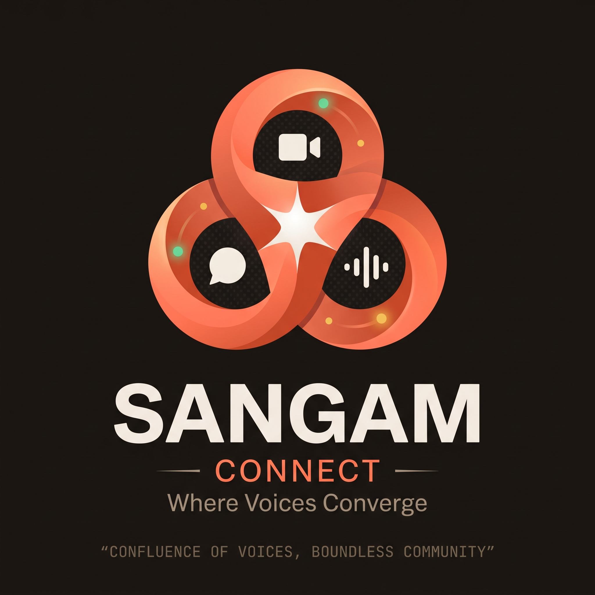
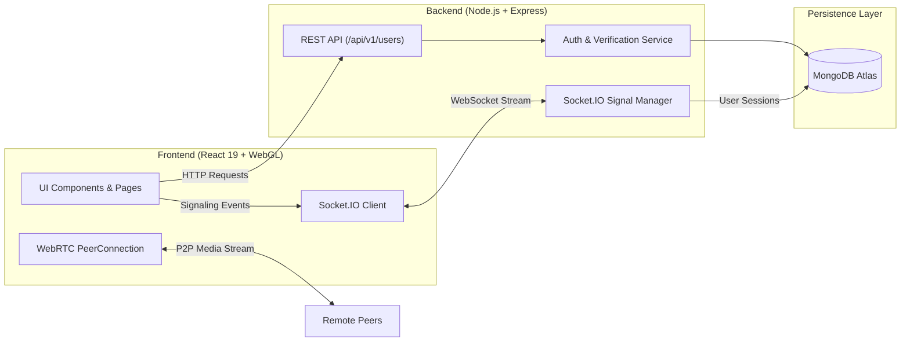

# Sangam Connect

<div align="center">



### Where Voices Converge

**A modern, premium video-conferencing and community platform engineered for real-time collaboration, low-latency media, and human connection.**

[](https://react.dev/)
[](https://nodejs.org/)
[](https://expressjs.com/)
[](https://socket.io/)
[](https://www.mongodb.com/)
[](https://webrtc.org/)
[](LICENSE)

</div>

---

## Table of Contents

- [Overview](#overview)
- [Key Features](#key-features)
- [System Architecture](#system-architecture)
- [Tech Stack](#tech-stack)
- [Project Structure](#project-structure)
- [Getting Started](#getting-started)
  - [Prerequisites](#prerequisites)
  - [Environment Configuration](#environment-configuration)
  - [Backend Setup](#backend-setup)
  - [Frontend Setup](#frontend-setup)
- [API Reference](#api-reference)
- [Design System & Theming](#design-system--theming)
- [Testing & Quality Assurance](#testing--quality-assurance)
- [Contributing & License](#contributing--license)

---

## Overview

**Sangam Connect** is built around one guiding principle: real-time communication should feel instant, reliable, and aesthetically refined.

Combining high-fidelity WebRTC mesh conferencing with a custom GPU-raymarched WebGL 3D centerpiece, Sangam Connect delivers seamless multi-party video calls, instant room generation, device diagnostics, meeting history, and a dual-theme design system (**Warm Paper** & **Charcoal Ember**).

---

## Key Features

### 🎥 High-Performance Video Conferencing
- **WebRTC Peer-to-Peer Mesh**: Low-latency direct media transport between participants.
- **Dynamic Meeting Layout**: Responsive multi-tile grid supporting 1, 2, 4, or more participants with automatic aspect-ratio balancing.
- **Mutual Exclusivity Side Panels**: Chat and participant panels dock cleanly without covering the main meeting grid.
- **Picture-in-Picture (PIP) Tile**: Floating self-view that automatically shifts when docking panels open.
- **In-Call Controls**: Instant microphone mute, video feed toggle, screen sharing, meeting duration timer, and chime synthesis.
- **Hardware Teardown**: Deterministic `AudioContext` lifecycle guards (`safeCloseAudioContext`) prevent memory leaks or audio crashes.

### 🎨 Dual-Theme Design System
- **Warm Charcoal & Ember (Dark Theme)**: Deep `#14120F` base, dark surfaces, restrained coral ambient lighting, and subtle grid lines.
- **Warm Paper & Ember (Light Theme)**: Refined `#FCF8F4` cream canvas, clean white cards, soft peach atmospheric lighting, and high-contrast typography.
- **Theme Isolation**: Scoped CSS tokens via `:root[data-theme="dark"]` and `:root[data-theme="light"]` with immediate cross-tab synchronization.

### 🧊 3D Raymarched WebGL Sculpture
- Native GPU-accelerated Raymarching WebGL canvas (`<SangamSculpture3D />`).
- Intertwined copper and coral ribbons with pointer parallax tracking, specular highlights, and Fresnel rim glow.
- Zero external 3D libraries (Three.js-free for blazing-fast bundle loading and minimal memory overhead).
- Pauses rendering when off-screen via `IntersectionObserver` and honors `prefers-reduced-motion`.

### 🔐 Robust Authentication & Account Lifecycle
- User registration and login powered by bcrypt password hashing and MongoDB Atlas storage.
- 6-digit OTP email verification flow with fallback developer bypass for local testing.
- "Keep me signed in" preference and password reset integration.
- `AuthContext` with automatic token persistence in `localStorage`.

### 📊 Dashboard & Device Preview Lobby
- Pre-call hardware preview with live camera and microphone testing.
- Connection diagnostics and latency indicator (`24 ms`).
- Meeting history feed with one-click rejoin and deletion.
- Fast join by meeting code or link.

---

## System Architecture



---

## Tech Stack

| Domain | Technology | Description |
| :--- | :--- | :--- |
| **Frontend Framework** | [React 19](https://react.dev/) | Component architecture, hooks, and context state management |
| **Routing** | [React Router 7](https://reactrouter.com/) | Client-side declarative routing and path protection |
| **Realtime Signaling** | [Socket.IO Client 4.8](https://socket.io/) | Full-duplex room orchestration and WebRTC exchange |
| **Media Transport** | [WebRTC](https://webrtc.org/) | Direct browser-to-browser audio, video, and screen sharing |
| **Visual Effects** | WebGL GLSL | Native GPU raymarched 3D ribbon sculpture |
| **Styling** | CSS Modules + Custom Tokens | Scoped component styling and dual-palette system (`palette.css`) |
| **Backend Runtime** | [Node.js](https://nodejs.org/) & [Express 4](https://expressjs.com/) | High-throughput asynchronous REST API and Socket server |
| **Database** | [MongoDB Atlas](https://www.mongodb.com/) & [Mongoose](https://mongoosejs.com/) | Scalable document store for user profiles, meetings, and activity logs |
| **Security** | `bcrypt`, `crypto`, CORS | Password salting, session tokens, and strict origin policy |
| **Testing** | [Jest](https://jestjs.io/) & [React Testing Library](https://testing-library.com/) | Automated unit, regression, and component test suites |

---

## Project Structure

```text
Sangam/
├── backend/
│   ├── src/
│   │   ├── app.js                    # Express app configuration, CORS, and HTTP server
│   │   ├── controllers/
│   │   │   ├── socketManager.js       # Real-time WebRTC room signaling and message relay
│   │   │   └── user.controller.js     # User registration, login, OTP verification, activity
│   │   ├── models/
│   │   │   ├── meeting.model.js       # Meeting record schema
│   │   │   └── user.model.js          # User credentials and session schema
│   │   ├── routes/
│   │   │   └── users.routes.js        # User authentication and activity routes
│   │   └── services/
│   │       └── emailService.js        # SMTP email dispatch & dev OTP generator
│   ├── package.json
│   └── .env                          # Backend environment variables
│
├── frontend/
│   ├── public/
│   │   ├── assets/                    # Optimized avatars, branding marks, and artwork
│   │   ├── index.html                 # App shell with typography preconnects
│   │   └── favicon.ico
│   ├── src/
│   │   ├── App.js                     # Root router and route guards
│   │   ├── components/
│   │   │   ├── SangamSculpture3D.jsx  # Native GPU raymarched WebGL centerpiece
│   │   │   └── ui/                    # SpotlightNavbar, ThemeToggle, RadialGlowButton, etc.
│   │   ├── contexts/
│   │   │   ├── AuthContext.jsx        # Authentication state, login, register, token sync
│   │   │   └── ThemeContext.jsx       # Theme state provider with cross-tab persistence
│   │   ├── pages/
│   │   │   ├── landing.jsx            # Marketing landing page with interactive preview
│   │   │   ├── authentication.jsx     # Dual-theme Sign In, Create Account & OTP Verify
│   │   │   ├── home.jsx               # Dashboard with media preview and recent meetings
│   │   │   ├── history.jsx            # Meeting history log and fast rejoin
│   │   │   └── VideoMeet.jsx          # Real-time WebRTC meeting conference room
│   │   ├── styles/
│   │   │   ├── palette.css            # Dark and light theme CSS variable tokens
│   │   │   ├── auth.module.css        # Scoped authentication page styling
│   │   │   ├── home.module.css        # Scoped dashboard layout styling
│   │   │   └── videoComponent.module.css # Scoped meeting room layout
│   │   └── utils/
│   │       ├── audioUtils.js          # Safe Web Audio lifecycle teardown
│   │       └── roomUtils.js           # Random meeting room code generator
│   ├── package.json
│   └── .env                          # Frontend environment variables
│
├── CHANGELOG.md                       # Comprehensive release and patch log
└── README.md                          # Documentation
```

---

## Getting Started

### Prerequisites

- **Node.js**: `v18.0.0` or higher
- **npm**: `v9.0.0` or higher
- **MongoDB**: A running local MongoDB instance or a free [MongoDB Atlas](https://www.mongodb.com/atlas) connection URI.

---

### Environment Configuration

#### 1. Backend (`backend/.env`)

Create a `.env` file in the `backend/` directory:

```env
PORT=8050
DATABASE_URL=mongodb+srv://<username>:<password>@<cluster>.mongodb.net/sangam
NODE_ENV=development

# Optional: Real SMTP email dispatch (defaults to console dev-code if omitted)
# SMTP_HOST=smtp.gmail.com
# SMTP_PORT=587
# SMTP_USER=your_email@gmail.com
# SMTP_PASS=your_app_password
```

#### 2. Frontend (`frontend/.env`)

Create a `.env` file in the `frontend/` directory:

```env
PORT=3001
REACT_APP_API_URL=http://localhost:8050
```

---

### Backend Setup

```bash
# Navigate to the backend directory
cd backend

# Install dependencies
npm install

# Start development server with auto-reload
npm run dev

# Or start in production mode
npm start
```

The backend server will listen at `http://localhost:8050`.

---

### Frontend Setup

```bash
# In a new terminal, navigate to the frontend directory
cd frontend

# Install dependencies
npm install

# Launch development server
npm start
```

The React frontend will start at `http://localhost:3001` (or whichever port is defined in `frontend/.env`).

---

## API Reference

Base Endpoint: `http://localhost:8050/api/v1/users`

| Method | Endpoint | Description | Payload / Params |
| :--- | :--- | :--- | :--- |
| `POST` | `/register` | Register new user and dispatch 6-digit OTP | `{ name, username, password }` |
| `POST` | `/login` | Authenticate user and receive session token | `{ username, password }` |
| `POST` | `/verify-email` | Verify 6-digit email confirmation code | `{ email, code }` |
| `POST` | `/resend-verification` | Request fresh verification OTP code | `{ email }` |
| `POST` | `/add_to_activity` | Record a completed or joined meeting | `{ token, meeting_code }` |
| `GET` | `/get_all_activity` | Retrieve user meeting history | `Query: token` |

---

## Design System & Theming

Sangam Connect features a tokenized CSS architecture in [`palette.css`](frontend/src/styles/palette.css). Themes can be toggled via the accessible header button (`ThemeToggle.jsx`) or programmatically using `useTheme()`.

| Token Category | Warm Charcoal & Ember (Dark, Default) | Warm Paper & Ember (Light) |
| :--- | :--- | :--- |
| `--bg-app` | `#14120F` | `#FCF8F4` |
| `--bg-surface` | `#221E19` | `#FFFFFF` |
| `--bg-card` | `rgba(28, 24, 20, 0.85)` | `#FFFFFF` |
| `--border` | `#3A3329` | `#E8E2D8` |
| `--text-primary` | `#F3EEE6` | `#14120E` |
| `--text-secondary` | `#A9A092` | `#635C50` |
| `--accent` | `#FF7A59` | `#E84D25` |
| `--shadow-lg` | `0 16px 48px rgba(0, 0, 0, 0.7)` | `0 20px 48px -8px rgba(50, 30, 20, 0.08)` |

Theme selection automatically persists to `localStorage` under `sangam_theme` and synchronizes across tabs via native browser storage events.

---

## Testing & Quality Assurance

Sangam Connect includes an automated test suite verifying WebRTC lifecycle handlers, network diagnostics, theme context switching, participant tile rendering, and authentication views.

```bash
# Run all frontend test suites
cd frontend
npm test -- --watchAll=false

# Run an optimized production build
npm run build
```

**Test Coverage Summary:**
- `ThemeContext.test.jsx`: Defaults, storage synchronization, cross-tab events.
- `authentication.test.jsx`: Light/dark rendering, asset selection, tab switching.
- `VideoMeet.mediaLifecycle.test.js`: AudioContext closure safety, track teardown.
- `VideoMeet.participantTile.test.jsx`: Stream attachment and socket guard verification.
- `audioUtils.test.js` & `roomUtils.test.js`: Utility math and string generation tests.

---

## Contributing & License

Contributions, feedback, and issue reports are welcome! Please feel free to open a pull request or submit an issue on GitHub.

Distributed under the **ISC License**. See [LICENSE](LICENSE) for more details.

---

<div align="center">
  <sub>Built with care for real-time human connection. <b>Sangam Connect</b> &copy; 2026.</sub>
</div>
