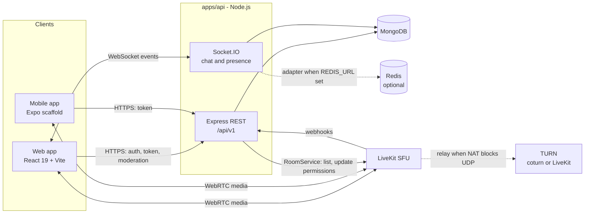
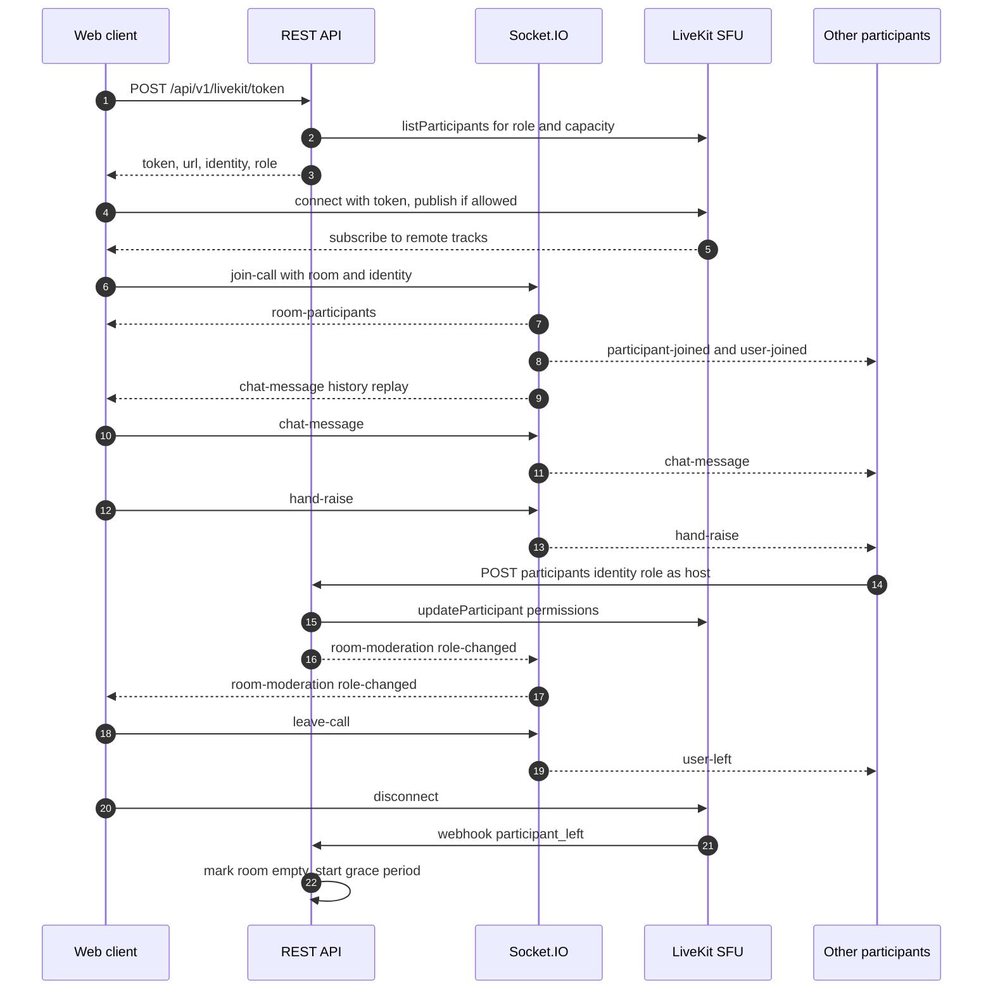
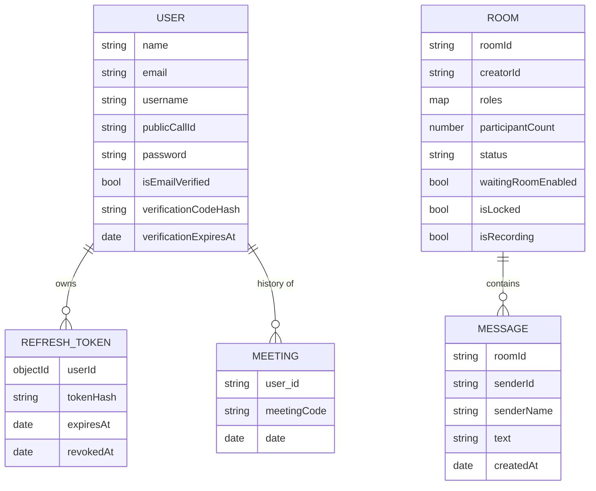

<div align="center">


# Sangam Connect

**Where Voices Converge**

Video meetings for small teams and large webinar-style rooms, built on a LiveKit SFU with a React + Node.js stack.

[](https://react.dev/)
[](https://vite.dev/)
[](https://nodejs.org/)
[](https://expressjs.com/)
[](https://socket.io/)
[](https://mongoosejs.com/)
[](https://livekit.io/)
[](LICENSE)

[Features](#key-features) · [Architecture](#system-architecture) · [Quick Start](#getting-started) · [API](#api-reference) · [Contributing](#contributing)

</div>

---

## Table of Contents

- [Overview](#overview)
- [Screenshots](#screenshots)
- [Key Features](#key-features)
- [System Architecture](#system-architecture)
- [Tech Stack](#tech-stack)
- [Project Structure](#project-structure)
- [Getting Started](#getting-started)
- [Usage Guide](#usage-guide)
- [API Reference](#api-reference)
- [Testing and Quality](#testing-and-quality)
- [Deployment](#deployment)
- [Troubleshooting](#troubleshooting)
- [Roadmap](#roadmap)
- [Contributing](#contributing)
- [License](#license)

---

## Overview

Sangam Connect is a video conferencing app. A LiveKit SFU forwards the audio and video. A Node.js API issues LiveKit tokens and handles accounts, room state and moderation. Socket.IO carries chat, reactions, hand-raise, captions and the waiting room.

Each room has server-assigned roles: host, co-host, speaker and attendee. Once a room grows past a set size, new joiners come in as listen-only attendees. A host can then let them speak live, without a rejoin. The web client has a dual-theme design system and a WebGL raymarched sculpture on the landing page.

---

## Screenshots

> No screenshots are in the repository yet. Add images under `docs/screenshots/` and replace the placeholders below.

| Landing | Home | Meeting room |
| :---: | :---: | :---: |
| _TODO: landing.png_ | _TODO: home.png_ | _TODO: meeting.png_ |

| Light theme | Dark theme |
| :---: | :---: |
| _TODO: theme-light.png_ | _TODO: theme-dark.png_ |

---

## Key Features

### Accounts and security
- Email and password sign-up with a 6-digit email OTP (expires in 10 minutes, attempt-limited, resend cooldown).
- JWT access tokens (15 min) with rotating refresh tokens and refresh-token reuse detection.
- Rate limits on the login, register, OTP and refresh endpoints. Request validation uses `zod`, plus `helmet`, an origin allow-list for CORS, and structured `pino` logs.

### Meetings
- **LiveKit SFU media:** camera, microphone and screen share go through the SFU, not peer-to-peer.
- **Roles:** host, co-host, speaker and attendee are resolved on the server. The room creator is host.
- **Large rooms:** above `LARGE_ROOM_THRESHOLD` (default 50), new joiners are listen-only attendees. `MAX_PARTICIPANTS` (default 500) caps a room with `ROOM_FULL`.
- **Hand-raise to speak:** attendees raise a hand, and hosts approve them from the participants panel. Permissions change live through the LiveKit server API.
- **Host controls:** mute all, mute one person, remove, lock or unlock the room, waiting room (admit or deny), transfer host, and promote or demote. Every control is checked on the server against the caller's LiveKit token.
- **Adaptive media:** `adaptiveStream`, `dynacast`, simulcast (180p and 360p layers), and Opus DTX/RED. Web and mobile share these settings in `packages/shared`.
- **In-call tools:** persistent chat with history replay, file and image attachments (sent inline as data URLs), emoji reactions, live captions (browser Web Speech API), gallery and speaker views with pages of 25 tiles, picture-in-picture, a device settings modal and keyboard shortcuts.
- **Room lifecycle:** an empty room expires after a 15-minute grace period (`ROOM_GRACE_PERIOD_MS`).
- **Personal rooms:** `/@username` links map to a permanent `user-<username>` room.
- **Network badge:** shows connection quality, and "Reconnecting" while LiveKit reconnects.
- **Recording and breakout rooms:** server state and broadcasts only. Recording does not call LiveKit Egress yet (see [Roadmap](#roadmap)).

### Interface
- **Dual-theme design system:** Warm Paper (light, `#FCF8F4` base) and Charcoal Ember (dark, `#14120F` base). Tokens live in `palette.css` and are scoped with `:root[data-theme]`, and the chosen theme syncs across browser tabs. The meeting room always uses the dark theme.
- **WebGL sculpture:** `SangamSculpture3D.jsx` renders a GPU-raymarched 3D ribbon in a native WebGL canvas.
- **Meeting history:** list, delete and clear past meeting codes.

---

## System Architecture

### High-level overview



### Call lifecycle



### Data model



### Design decisions and limitations

- **SFU instead of mesh.** In a mesh, each client uploads one stream per peer, so upload grows with room size. With the SFU, each publisher uploads once and LiveKit forwards a suitable simulcast layer to each viewer. Large rooms work by keeping most people as attendees.
- **Server-side roles.** The server never trusts a client's identity or role. A logged-in user gets the identity `u-<userId>-<random>`, so two tabs don't kick each other. A guest gets `g-<random>`.
- **Per-process socket state.** The Redis adapter exists, but `socketManager.js` keeps room membership in memory. Running more than one API process needs Phase 4 of `docs/livekit-migration-plan.md`.
- **Remove is cooperative.** "Remove participant" asks the client to leave. It does not call LiveKit `removeParticipant` yet.
- **Webhook URL.** `livekit.yaml` posts webhooks to `127.0.0.1:8002`. It must match the API `PORT`.

---

## Tech Stack

| Domain | Technology | Version | Purpose |
| --- | --- | --- | --- |
| Web UI | React / React DOM | 19.2.7 | Component UI |
| Routing | React Router DOM | 7.18.1 | Client routes |
| Build | Vite | 8.3.4 | Dev server and bundler |
| UI kit | MUI Material + Icons | 9.2.0 | Icons and primitives |
| Media client | livekit-client | 2.23.0 | WebRTC to the SFU |
| Media UI | @livekit/components-react | 2.9.24 | Room context and hooks |
| Realtime client | socket.io-client | 4.8.3 | Chat and presence |
| HTTP client | axios | 1.18.1 | API calls (`packages/api-client`) |
| API server | Express | 5.2.1 | REST API |
| Realtime server | Socket.IO | 4.8.3 | Events |
| Database | MongoDB + Mongoose | 9.7.4 | Users, rooms, messages, history |
| Cache / scale-out | ioredis + @socket.io/redis-adapter | 6.0.0 / 8.3.0 | Optional adapter |
| Media server | LiveKit server (Docker) | v1.7 | SFU |
| Media server API | livekit-server-sdk | 2.19.2 | Live permission updates |
| Auth | jsonwebtoken / bcrypt | 9.0.3 / 6.0.0 | Tokens and password hashing |
| Validation | zod | 4.6.7 | Request schemas |
| Security | helmet / express-rate-limit | 8.3.0 / 8.7.1 | Headers and rate limits |
| Email | nodemailer | 9.0.5 | OTP delivery |
| Logging | pino / pino-http | 10.4.0 / 11.x | Structured logs |
| Tests | node:test / Vitest + Testing Library | built-in / 5.0.5 | API and web tests |
| Mobile | Expo + @livekit/react-native | ~52 / ^2.7 | Scaffold (see Roadmap) |

---

## Project Structure

```text
.
├── apps/
│   ├── api/                          # Node.js API (Express + Socket.IO)
│   │   ├── .env.example              # API environment template
│   │   ├── MIGRATIONS.md             # Auth and security migration notes
│   │   └── src/
│   │       ├── app.js                # Server bootstrap, middleware, routes, shutdown
│   │       ├── config/               # Env validation (index.js) and CORS allow-list (cors.js)
│   │       ├── controllers/
│   │       │   ├── socketManager.js  # Socket.IO events: chat, presence, hand-raise, captions
│   │       │   └── user.controller.js# Auth, OTP, refresh rotation, history
│   │       ├── middlewares/error.js  # 404 and JSON error handler
│   │       ├── models/               # user, refreshToken, meeting, room, message
│   │       ├── routes/
│   │       │   ├── users.routes.js   # /api/v1/users
│   │       │   ├── livekit.routes.js # /api/v1/livekit (token, webhook)
│   │       │   ├── room.routes.js    # /api/v1/rooms (state, moderation, roles)
│   │       │   └── health.routes.js  # /health and /ready
│   │       ├── services/
│   │       │   ├── livekit.service.js# Token minting, roles, RoomService client
│   │       │   ├── roomState.service.js # Redis or in-memory room state
│   │       │   └── email.service.js  # SMTP, Ethereal or console OTP delivery
│   │       ├── validators/index.js   # zod request schemas
│   │       ├── utils/logger.js       # pino logger
│   │       └── __tests__/            # node:test suites
│   ├── web/                          # React 19 + Vite client
│   │   ├── .env.example              # Web environment template
│   │   ├── index.html
│   │   ├── vite.config.js            # Port 5173, proxy to :8002
│   │   ├── public/assets/            # Branding and illustration images
│   │   └── src/
│   │       ├── App.jsx               # Route map
│   │       ├── environment.js        # API base URL
│   │       ├── components/           # ParticipantsPanel, NetworkStatusBadge, SangamSculpture3D, ui/
│   │       ├── contexts/             # AuthContext, ThemeContext
│   │       ├── hooks/                # useNetworkDiagnostics
│   │       ├── lib/                  # api.js (axios), socket.js (Socket.IO singleton)
│   │       ├── pages/                # landing, authentication, home, history, VideoMeet
│   │       ├── styles/               # CSS modules and palette.css theme tokens
│   │       └── utils/                # withAuth guard, room and audio helpers
│   └── mobile/                       # Expo / React Native scaffold
│       ├── App.tsx
│       └── src/screens/              # AuthScreen, HomeScreen, RoomScreen
├── packages/
│   ├── shared/                       # Shared helpers and LiveKit ROOM_OPTIONS
│   ├── api-client/                   # axios client with token refresh
│   └── tokens/                       # Design tokens (colors) for mobile
├── docs/
│   ├── livekit-migration-plan.md     # SFU migration and large-room plan
│   ├── local-testing-guide.md
│   ├── qa-manual-matrix.md
│   └── turn-configuration.md
├── docker-compose.yml                # LiveKit, Redis, coturn, Egress
├── livekit.yaml                      # LiveKit server config (dev keys)
├── package.json                      # npm workspaces and root scripts
├── CHANGELOG.md
└── LICENSE
```

---

## Getting Started

### Prerequisites

| Tool | Version | Notes |
| --- | --- | --- |
| Node.js | 18 or later | Developed on Node 22. No `engines` field is set. |
| npm | 9 or later | Workspaces support |
| MongoDB | Local or Atlas | Connection URI in `DATABASE_URL` |
| Docker + Compose | Any recent | Runs LiveKit and Redis |

### 1. Clone

```bash
git clone <your-fork-url> sangam-connect
cd sangam-connect
```

### 2. Configure environment

```bash
cp apps/api/.env.example apps/api/.env
cp apps/web/.env.example apps/web/.env
```

Edit `apps/api/.env`. At minimum, set `DATABASE_URL`, `JWT_SECRET` and `JWT_REFRESH_SECRET`. Generate the secrets with `openssl rand -hex 32`.

### 3. Start LiveKit and Redis

```bash
docker compose up -d livekit redis
```

> Do not run a plain `docker compose up`. The `livekit-egress` service mounts an `egress.yaml` that is not in the repository, so that service fails to start.

### 4. Install dependencies

`apps/mobile` pins `@livekit/react-native-webrtc@^124.0.0`, a version that does not exist, so the workspace install fails. Bump it once to the version `@livekit/react-native` expects, then install from the root:

```bash
npm pkg set "dependencies.@livekit/react-native-webrtc=^144.1.2" -w apps/mobile
npm install
```

> The web app depends on the local `@sangam/*` packages, so install from the root. Do not install inside `apps/web` alone.

### 5. Run

```bash
npm run dev
```

This starts the API (`nodemon`, port **8002**) and the web app (Vite, port **5173**).

> **Windows:** `npm run dev` uses `&`, which `cmd.exe` does not run in parallel. Use two terminals instead: `npm run dev -w apps/api` and `npm run dev -w apps/web`.

### 6. Verify

- Open <http://localhost:8002/health>. It should return `{"status":"ok","ts":...}`.
- Open <http://localhost:5173>. You should see the landing page with the 3D sculpture.
- <http://localhost:8002/ready> returns `503` until MongoDB is connected.

### Environment variables

#### API (`apps/api/.env`)

| Variable | Required | Default | Description |
| --- | :---: | --- | --- |
| `DATABASE_URL` | Yes | – | MongoDB connection string. The server exits without it. |
| `JWT_SECRET` | Yes | – | Access-token secret, at least 32 characters |
| `JWT_REFRESH_SECRET` | Yes | – | Refresh-token secret, at least 32 characters |
| `PORT` | No | `8002` | API port |
| `NODE_ENV` | No | `development` | `production` turns on `trust proxy` and webhook signature checks |
| `CLIENT_ORIGINS` | No | `http://localhost:5173,http://localhost:3000` | Comma-separated CORS allow-list |
| `LIVEKIT_URL` | No | `ws://localhost:7880` | LiveKit WebSocket URL |
| `LIVEKIT_API_KEY` | No | `devkey` | Must match `keys:` in `livekit.yaml` |
| `LIVEKIT_API_SECRET` | No | `devsecret` | Must match `livekit.yaml`. The dev config there uses `secret`. |
| `LARGE_ROOM_THRESHOLD` | No | `50` | New joiners become attendees at or above this count |
| `MAX_PARTICIPANTS` | No | `500` | Token requests beyond this get `403 ROOM_FULL` |
| `ROOM_GRACE_PERIOD_MS` | No | `900000` | How long an empty room lives before it expires |
| `REDIS_URL` | No | – | Turns on the Socket.IO Redis adapter |
| `SMTP_HOST` / `SMTP_PORT` / `SMTP_USER` / `SMTP_PASS` | No | port `587` | OTP email. `EMAIL_*` names also work. |
| `LOG_LEVEL` | No | `info` | pino log level |

#### Web (`apps/web/.env`)

| Variable | Required | Default | Description |
| --- | :---: | --- | --- |
| `VITE_API_URL` | No | `http://localhost:8002` in dev | API base URL |
| `VITE_ADAPTIVE_MEDIA` | No | `true` | Set `false` to drop the shared LiveKit options |

---

## Usage Guide

1. **Sign up** at `/register`. In development without SMTP, the API console prints the OTP:
   ```text
   Verification OTP: 123456
   ```
2. **Verify** the code at `/verify-email`, then sign in at `/login`.
3. **Start or join** a meeting from `/home`, or open `/<room-code>` directly. `/@username` opens that user's personal room.
4. **Lobby:** preview your camera and mic, pick devices, enter a name and join. The first person to join a room becomes host.
5. **Share** the room code with the copy button in the meeting header.
6. **In the meeting:**

| Control | Shortcut | Who |
| --- | :---: | --- |
| Microphone | `M` | Speakers and above |
| Camera | `V` | Speakers and above |
| Screen share | `S` | Speakers and above |
| Raise hand | `H` | Everyone |
| Chat | `C` | Everyone |
| Participants panel | `P` | Everyone |
| Leave confirmation | `Esc` | Everyone |
| Captions, reactions, view mode, settings | – | Everyone |
| Record, lock, mute all, waiting room | – | Host and co-host |
| Allow to speak, Audience, Co-host, Transfer host | – | From the participants panel (co-host changes are host only) |

---

## API Reference

Base URL: `http://localhost:8002`. All bodies are JSON.

### Users: `/api/v1/users`

| Method | Path | Auth | Body | Response |
| --- | --- | --- | --- | --- |
| POST | `/register` | – (rate-limited) | `name`, `email`, `password`, `acceptTerms: true` | `201` + message, then OTP sent |
| POST | `/verify-email` | – (rate-limited) | `email`, `code` or `otp` | `200` + message |
| POST | `/resend-verification` | – (rate-limited) | `email` | `200`, or `429` during cooldown |
| POST | `/login` | – (rate-limited) | `email` or `username`, `password` | `accessToken`, `refreshToken`, `user` (`403` if not verified) |
| POST | `/refresh` | – (30 per 15 min) | `refreshToken` | New `accessToken` + `refreshToken` (rotated) |
| POST | `/logout` | – | `refreshToken` (optional) | Revokes the refresh token |
| GET | `/me` | Bearer access token | – | `user` |
| POST | `/add_to_activity` | Bearer access token | `meeting_code` or `meetingCode` | `201` |
| GET / POST | `/get_all_activity` | Bearer access token | – | Meeting history |
| DELETE / POST | `/delete_activity` and `/delete_activity/:id` | Bearer access token | – | Deletes one entry |
| DELETE / POST | `/clear_activity` | Bearer access token | – | Clears history |
| GET | `/@:username/room` | – | – | `roomId`, `roomUrl`, `isPersonalRoom` |

### LiveKit: `/api/v1/livekit`

| Method | Path | Auth | Body | Response |
| --- | --- | --- | --- | --- |
| POST | `/token` | Optional Bearer access token | `roomName`, `name`, `avatar` (client `identity` and `roomAdmin` are ignored) | `token`, `url`, `identity`, `role`, `isHost`, `isWaiting`, `isLocked`, `isRecording`. `403` with `ROOM_EXPIRED`, `ROOM_LOCKED` or `ROOM_FULL`. |
| POST | `/webhook` | LiveKit signature (enforced in production) | LiveKit event (`application/webhook+json`) | Updates room status and `participantCount` |

### Rooms: `/api/v1/rooms/:roomId`

"LiveKit token" means `Authorization: Bearer <the caller's LiveKit token>` for the same room. The role is read from the server.

| Method | Path | Auth | Body | Response |
| --- | --- | --- | --- | --- |
| GET | `/messages` | – | Query `limit` (max 100), `before` | Chat history, oldest first |
| GET | `/state` | – | – | Lock, waiting room, recording, creator and breakout state |
| POST | `/moderation` | LiveKit token, host or co-host | `action` (`mute-all`, `mute-individual`, `remove-participant`, `lock-room`, `unlock-room`, `transfer-host`, `toggle-waiting-room`), `targetIdentity` | Broadcasts `room-moderation`. `transfer-host` is host only. |
| POST | `/participants/:identity/role` | LiveKit token, host or co-host | `role` (`speaker`, `attendee`, `cohost`) | `{ identity, role, live }`. Co-host changes are host only. |
| POST | `/recording/start` and `/recording/stop` | LiveKit token, host or co-host | – | Recording state and `recording-status` broadcast |
| POST | `/breakout/create` | LiveKit token, host or co-host | `rooms: [{ name, participants }]` | `breakout-broadcast` |
| POST | `/breakout/close` | LiveKit token, host or co-host | – | `breakout-broadcast` |
| POST | `/upload` | – | `fileName`, `fileType`, `fileData` (data URL) | Echoes the file back (no storage) |

### Health

| Method | Path | Response |
| --- | --- | --- |
| GET | `/health` | `200 { status: "ok" }` |
| GET | `/ready` | `200` or `503` with MongoDB, Redis and LiveKit checks |

### Socket.IO events

| Event | Direction | Payload |
| --- | --- | --- |
| `join-call` | client to server | `roomPath`, `{ username, identity, userId, isGuest, mediaState }` |
| `room-participants` | server to joiner | Map of the room's participants |
| `participant-joined` | server to room | Participant metadata |
| `user-joined` | server to room | `socketId`, member list, metadata |
| `room-error` | server to client | `{ code: "ROOM_EXPIRED", message }` |
| `leave-call` | client to server | – |
| `user-left` | server to room | `socketId` |
| `media-state` / `media-state-changed` | client to server / server to room | `{ camera, mic, screenSharing, isSpeaking }` |
| `chat-message` | both | `data`, `sender`, `socketId`, `messageId` (history replays on join) |
| `reaction` | both | Emoji / `{ emoji, senderId, senderName, timestamp }` |
| `hand-raise` | both | `{ raised, roomId }` / `{ socketId, identity, raised }` |
| `transcription-chunk` | both | `{ text, speaker, isFinal, roomId }` |
| `waiting-room-join` | client to server | `{ roomId, identity, name }` |
| `waiting-room-request` | server to room | `{ identity, name, socketId, roomId }` |
| `waiting-room-decision` / `waiting-room-response` | host to server / server to guest | `{ approved, roomId, targetIdentity }` |
| `room-moderation` | server to room (REST only) | `{ action, targetIdentity, callerIdentity, role }` |
| `recording-status` | server to room | `{ isRecording, recordingId }` |
| `breakout-broadcast` | server to room | `{ action, breakoutRooms }` |

---

## Testing and Quality

```bash
npm test          # API (node:test) then web (Vitest)
npm run build     # Production build of apps/web to apps/web/dist
```

| Suite | Covers |
| --- | --- |
| `apps/api/src/__tests__/auth_security.test.js` | Env validation, CORS, JWT shape, refresh rotation and reuse detection, logout, rate limits |
| `apps/api/src/__tests__/backend.test.js` | Token claims, socket reaction relay, join dedup, multi-tab, room expiry |
| `apps/api/src/__tests__/backend_hardening.test.js` | zod validators, `/health`, `/ready`, error handlers |
| `apps/api/src/__tests__/livekit_sfu.test.js` | Token grants, webhook signatures, `ROOM_EXPIRED`, message history |
| `apps/api/src/__tests__/phase6_features.test.js` | Room state, moderation, recording, breakout, upload, personal rooms, locked rooms |
| `apps/api/src/__tests__/roles.test.js` | Role grants, threshold, `ROOM_FULL`, promote and demote, co-host rules, webhook parsing |
| `apps/web/src/pages/__tests__/*` | Auth page, history page, VideoMeet layout, media lifecycle, tiles, screen share, role controls |
| `apps/web/src/contexts/__tests__/*` | AuthContext, ThemeContext |
| `apps/web/src/components/__tests__/NetworkStatusBadge.test.jsx` | Reconnecting state |
| `apps/web/src/hooks/__tests__/useNetworkDiagnostics.test.js` | Quality metrics |
| `apps/web/src/utils/__tests__/*` | Room code helpers, audio context safety, shared LiveKit options |

There is no CI pipeline yet.

---

## Deployment

The repository has no deployment scripts. The code shows these production requirements:

- Set `NODE_ENV=production`. Express then trusts one reverse proxy (for correct rate-limit IPs), and the server rejects LiveKit webhooks without a valid signature.
- Set `CLIENT_ORIGINS` to your web origin(s). Requests from other origins are rejected.
- Set `LIVEKIT_URL`, `LIVEKIT_API_KEY` and `LIVEKIT_API_SECRET`. Without `LIVEKIT_URL`, production falls back to `wss://sangam.livekit.cloud`.
- Build the web app with `npm run build`, then serve `apps/web/dist`. Set `VITE_API_URL` at build time. Without it, production builds use `https://antarsetubackend.onrender.com`.
- For users behind strict NAT, configure TURN. See [`docs/turn-configuration.md`](docs/turn-configuration.md).
- `livekit.yaml` and `docker-compose.yml` contain development keys and passwords. Replace them before deploying.

---

## Troubleshooting

| Problem | Fix |
| --- | --- |
| Camera or mic not working | Allow the permission in the browser. If another app holds the camera, the lobby falls back to audio only. Browsers allow media only on `localhost` or HTTPS. |
| Web app can't reach the API | The web app and the Vite proxy expect port **8002**. Set `PORT=8002` in `apps/api/.env`, or set `VITE_API_URL` to your port. |
| CORS error | Add your web origin to `CLIENT_ORIGINS`. |
| API exits on start | `DATABASE_URL`, `JWT_SECRET` or `JWT_REFRESH_SECRET` is missing, or a secret is shorter than 32 characters. |
| `/ready` returns 503 | MongoDB isn't reachable. Check the URI and the Atlas IP allow-list. |
| No OTP email | Without SMTP, the code is printed in the API console. |
| Video fails on some networks | Configure TURN, because WebRTC cannot cross restrictive NATs without a relay. |
| Promote or demote returns `live: false` | `LIVEKIT_API_KEY` and `LIVEKIT_API_SECRET` don't match `livekit.yaml`, or LiveKit isn't running. |
| Room status never changes | The `livekit.yaml` webhook URL must point to the API's real port. |
| Root `npm install` fails with `notarget @livekit/react-native-webrtc` | Apply the version bump in step 4. |

---

## Roadmap

- [ ] Tile virtualization with active-speaker ordering, and no subscriptions for off-screen tiles (Phase 3)
- [ ] Socket.IO room state in Redis, per-socket rate limits, reaction batching (Phase 4)
- [ ] Production `livekit.yaml` and Compose: env-based keys, TLS, built-in TURN, `egress.example.yaml` (Phase 5)
- [ ] Staged load tests at 25 to 300 participants (Phase 6)
- [ ] Real recording through LiveKit Egress
- [ ] Server-side kick with LiveKit `removeParticipant`
- [ ] Verify the Socket.IO handshake token
- [ ] Commit the mobile `@livekit/react-native-webrtc` bump and test the Expo build
- [ ] CI pipeline running `npm test` and `npm run build`
- [ ] Add screenshots

---

## Contributing

1. Fork the repo and create a branch: `git checkout -b feat/short-description`.
2. Make your change and add tests.
3. Run `npm test` and `npm run build`.
4. Use [Conventional Commits](https://www.conventionalcommits.org/), for example `feat(web): add speaker ordering`.
5. Open a pull request that describes the change and how you tested it.

Never commit `.env` files, credentials or connection strings.

---

## License

Distributed under the ISC License. See [LICENSE](LICENSE).

---

<div align="center">

Built by **aniket** · Sangam Connect: Where Voices Converge

</div>
