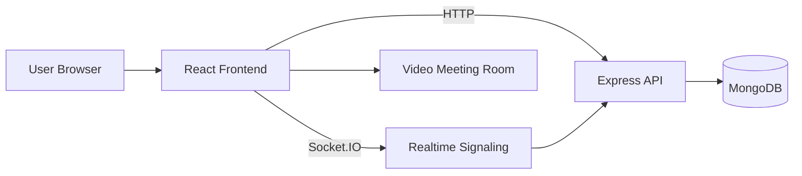

# Antar Setu

<div align="center">

**Bridge people across distance with secure, real-time video meetings.**

A polished Zoom-style meeting platform built with **React**, **Express**, **MongoDB**, and **Socket.IO**.

</div>

---

## Why Antar Setu

Antar Setu is designed around one idea: meetings should feel instant, reliable, and human.

- Real-time video meeting flow with WebRTC-style peer connections
- Socket-powered signaling for live session coordination
- Authentication with register/login support
- Modern landing experience with a bold visual presentation
- Responsive UI built with React and Material UI

---

## Tech Stack

| Layer     | Tools                                   |
| --------- | --------------------------------------- |
| Frontend  | React, React Router, Material UI, Axios |
| Realtime  | Socket.IO Client                        |
| Backend   | Node.js, Express, Socket.IO             |
| Database  | MongoDB, Mongoose                       |
| Utilities | bcrypt, CORS                            |

---

## Architecture



The app uses the frontend for navigation and meeting UI, while the backend handles authentication and realtime signaling. MongoDB stores user data, and Socket.IO keeps meeting state synchronized.

---

## Features

### Landing Experience

- Impactful hero section with animated UI elements
- Strong product storytelling and meeting-focused design
- CTA-driven flow into authentication and meeting entry

### Authentication

- Register and login screens
- Password hashing with `bcrypt`
- Token-based session flow stored in MongoDB

### Meeting Experience

- Join meeting routes through dynamic URLs
- Audio/video device access
- Screen sharing support
- Chat and participant state handling
- Socket-based signaling between peers

---

## Project Structure

```text
Zoom Clone/
├── backend/
│   ├── src/
│   │   ├── app.js
│   │   ├── controllers/
│   │   ├── models/
│   │   └── routes/
│   └── package.json
├── frontend/
│   ├── src/
│   │   ├── App.js
│   │   ├── contexts/
│   │   ├── pages/
│   │   ├── styles/
│   │   └── utils/
│   └── package.json
└── README.md
```

---

## Getting Started

### 1. Clone the repository

```bash
git clone <repo-url>
cd Zoom\ Clone
```

### 2. Install backend dependencies

```bash
cd backend
npm install
```

### 3. Install frontend dependencies

```bash
cd ../frontend
npm install
```

### 4. Start the backend

```bash
cd ../backend
npm run dev
```

The backend runs on port `8001` by default.

### 5. Start the frontend

```bash
cd ../frontend
npm start
```

The frontend runs on port `3000` by default.

---

## Available Scripts

### Backend

- `npm run dev` - start the backend with nodemon
- `npm start` - start the backend in production mode
- `npm run prod` - start the backend with pm2

### Frontend

- `npm start` - start the React development server
- `npm run build` - create a production build
- `npm test` - run the test suite
- `npm run eject` - eject from Create React App

---

## API Endpoints

Base path: `/api/v1/users`

| Method | Endpoint    | Purpose             |
| ------ | ----------- | ------------------- |
| POST   | `/register` | Create a new user   |
| POST   | `/login`    | Authenticate a user |

There are also placeholder routes for activity tracking:

- `/add_to_activity`
- `/get_all_activity`

---

## Configuration Notes

- The backend currently connects to MongoDB using the URI defined in `backend/src/app.js`.
- For production, move secrets and connection strings into environment variables.
- Update `server_url` in `frontend/src/pages/VideoMeet.jsx` if your backend runs on a different host or port.

---

## Browser Support

The meeting experience depends on browser media permissions and WebRTC support. For the best results, use a modern Chromium-based browser.

---

## Roadmap

- Move backend credentials to environment variables
- Complete activity tracking routes
- Add room persistence and participant metadata
- Improve fallback handling for media permissions
- Add deployment documentation

---

## License

ISC
